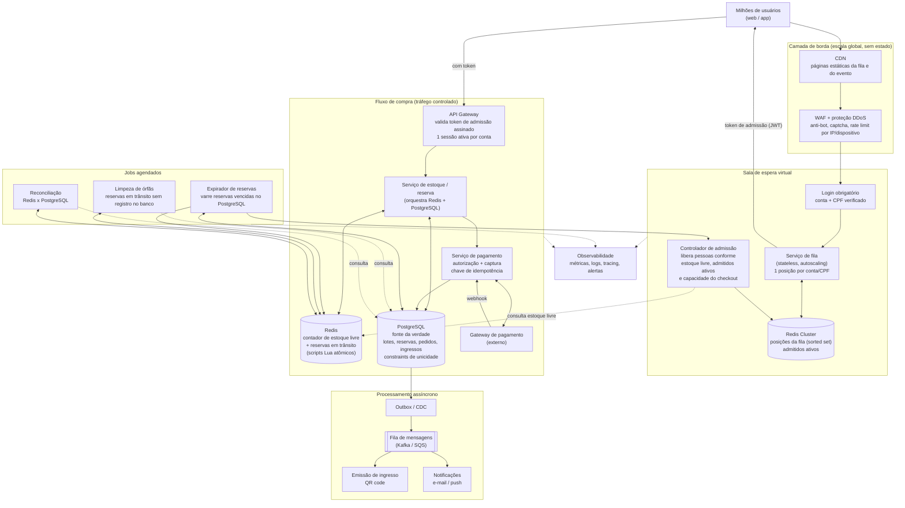
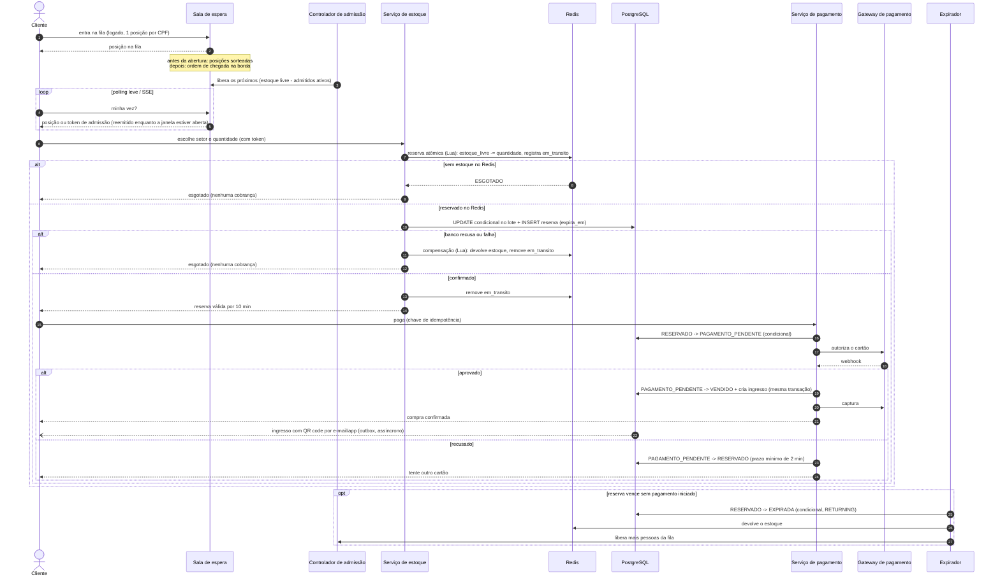
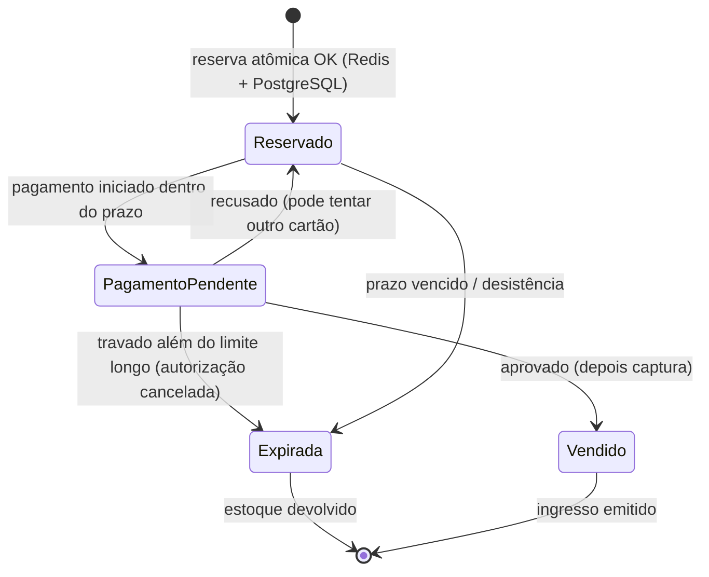

# Arquitetura: venda de ingressos para um mega show de rock

Desenho de um sistema de venda de ingressos para um evento com demanda muito maior que a oferta. Ele é guiado por três requisitos:

1. **Aguentar qualquer volume de acessos simultâneos** sem derrubar o site.
2. **Nunca vender mais ingressos do que existem** (sem overselling, sem "compra aprovada e depois cancelada").
3. **Justiça**: uma pessoa com internet lenta não pode perder o ingresso só porque outra tem conexão mais rápida.

A ideia central: **o estoque não é disputado pela multidão**. A multidão fica em uma fila virtual barata, servida pela borda (CDN). Só entra no fluxo de compra quem tem chance real de comprar, e cada ingresso é **reservado de forma atômica** antes do pagamento. O cartão só é cobrado depois que o ingresso já está garantido.

---

## 1. Visão geral



---

## 2. Como cada requisito é atendido

### 2.1 Volume de acessos independente da demanda

| Camada | Como escala |
|---|---|
| **CDN** | Serve a página do evento e a página da fila como conteúdo estático. O pico de milhões de acessos bate na borda, não nos servidores. |
| **WAF / anti-bot** | Descarta bots, scalpers e excesso de requisições antes de chegar à aplicação. |
| **Sala de espera** | Serviço sem estado, escala horizontalmente. Cada usuário custa só uma entrada em um sorted set no Redis e um polling leve (ou SSE) a cada poucos segundos. |
| **Controlador de admissão** | É a "válvula": o fluxo de compra recebe só a vazão que consegue processar, não importa se há 100 mil ou 10 milhões na fila. |
| **Fluxo de compra** | Como a entrada é controlada, o banco de dados nunca recebe a avalanche. Serviços em containers com autoscaling, multi-AZ. |
| **Assíncrono** | Emissão do ingresso, e-mail e push saem do caminho crítico pela fila de mensagens. |

### 2.2 Admissão: só entra quem tem chance real

O controlador de admissão não olha só o estoque livre. Ele desconta quem já foi admitido e ainda não reservou, considerando o pior caso (cada pessoa comprar o limite por CPF):

```
vagas = (estoque_livre - admitidos_sem_reserva x limite_por_pessoa) / limite_por_pessoa
admitir min(vagas, capacidade_do_checkout) pessoas
```

- Quando um admitido reserva menos que o limite, ou desiste, ou o token dele vence, a sobra volta para o cálculo e mais gente é admitida.
- Quando `estoque_livre = 0` e não há reservas ativas nem pagamentos pendentes, a fila mostra **"esgotado"** imediatamente, em vez de deixar milhões de pessoas esperando à toa.
- Enquanto houver reservas que podem voltar ao estoque, a fila mostra "aguardando possíveis desistências" com a posição real.

### 2.3 Nunca vender o que não existe

O **Serviço de estoque** orquestra a reserva em dois passos, com compensação:

1. **Reserva atômica no Redis** (script Lua, executado de forma indivisível):
   ```
   se estoque_livre >= quantidade:
       estoque_livre -= quantidade
       registra em "em_transito": (reserva_id, quantidade, criado_em = agora)
       retorna OK
   senão:
       retorna ESGOTADO
   ```
   Dois usuários nunca conseguem o mesmo ingresso, porque o Redis executa o script em série.

2. **Confirmação no PostgreSQL** (fonte da verdade), em uma única transação:
   ```sql
   UPDATE lote
      SET reservados = reservados + :quantidade
    WHERE id = :lote_id
      AND vendidos + reservados + :quantidade <= total;
   -- 0 linhas afetadas => sem estoque, a reserva é recusada

   INSERT INTO reserva (id, lote_id, conta_id, quantidade, status, expira_em)
   VALUES (:reserva_id, :lote_id, :conta_id, :quantidade, 'RESERVADO', now() + interval '10 minutes');
   ```
   Mais uma constraint `UNIQUE` por ingresso/assento. Se o Redis divergir, o banco ainda impede a venda acima do total.

3. **Compensação**: depois do passo 2, o serviço remove a reserva de `em_transito`. Se o PostgreSQL recusar ou der erro, outro script Lua devolve a quantidade a `estoque_livre` e remove a entrada de `em_transito`. Se o serviço cair entre os dois passos, a **limpeza de órfãs** encontra entradas de `em_transito` com mais de 30 s sem reserva correspondente no banco e devolve o estoque.

### 2.4 Pagamento e expiração sem corrida

Toda mudança de estado da reserva é um `UPDATE` condicional no PostgreSQL. Só um caminho vence, mesmo que o expirador e o webhook rodem ao mesmo tempo.

| Transição | Comando | Quem executa |
|---|---|---|
| Iniciar pagamento | `UPDATE reserva SET status = 'PAGAMENTO_PENDENTE' WHERE id = :id AND status = 'RESERVADO' AND expira_em > now()` | Serviço de pagamento, **antes** de chamar o gateway. 0 linhas: não envia nada ao gateway. |
| Pagamento aprovado | `UPDATE reserva SET status = 'VENDIDO' WHERE id = :id AND status = 'PAGAMENTO_PENDENTE'` + cria o ingresso + `vendidos += quantidade`, `reservados -= quantidade` no lote, na mesma transação | Webhook. Só depois do commit a autorização do cartão é **capturada**. |
| Pagamento recusado | `UPDATE reserva SET status = 'RESERVADO', expira_em = greatest(expira_em, now() + interval '2 minutes') WHERE id = :id AND status = 'PAGAMENTO_PENDENTE'` | Webhook. O cliente tenta outro cartão sem perder a reserva. |
| Reserva vencida | `UPDATE reserva SET status = 'EXPIRADA' WHERE status = 'RESERVADO' AND expira_em < now() RETURNING id, lote_id, quantidade` + `reservados -= quantidade` no lote | Expirador, a cada poucos segundos. Para cada linha retornada, devolve a quantidade ao Redis e avisa o controlador de admissão. |
| Pagamento travado | Só depois de um limite longo (ex.: 30 min) em `PAGAMENTO_PENDENTE`: consulta o gateway. Aprovado segue como aprovado; caso contrário, cancela a autorização e expira a reserva. | Expirador |

Consequências:
- **O expirador nunca toca uma reserva em `PAGAMENTO_PENDENTE`.** Quem inicia o pagamento aos 9:50 dos 10 minutos não perde o ingresso enquanto o banco do cartão responde.
- **O cartão só é cobrado (captura) quando a reserva já virou `VENDIDO`.** Não existe "aprovado e depois estornado" no fluxo de venda. No pior caso, uma autorização não capturada é cancelada e o cliente não chega a ser cobrado.
- **Idempotência**: cada tentativa de pagamento tem uma chave de idempotência, então cliques duplos, retries do cliente ou webhooks repetidos não geram dupla cobrança nem dois ingressos.
- **A expiração é decidida pelo PostgreSQL** (`expira_em`), não por TTL de chave no Redis. Nenhuma reserva some sem devolver o estoque.

### 2.5 Reconciliação

O job de reconciliação compara o contador do Redis com o banco levando em conta as reservas em trânsito:

```
esperado = total - vendidos - reservados (PostgreSQL) - soma(em_transito ainda não confirmadas)
```

Ele só corrige o Redis quando a divergência aparece em duas leituras seguidas, com alguns segundos de intervalo. Assim, uma reserva que estava entre o passo 1 e o passo 2 no momento da leitura não recria estoque inexistente. Toda correção gera alerta.

### 2.6 Justiça para quem tem internet lenta

A velocidade da conexão deixa de importar porque **a ordem é decidida no servidor, não por quem clica primeiro**:

- **Uma posição por pessoa**: para entrar na fila é preciso estar logado com CPF verificado. A posição fica amarrada à conta e ao CPF, não à aba ou ao dispositivo. Abrir 50 abas ou 50 aparelhos devolve sempre a mesma posição.
- **Pré-fila com sorteio**: a sala de espera abre antes do horário da venda (ex.: 30 min antes). Todos que entrarem até a abertura recebem uma **posição aleatória** no momento da abertura. Chegar 1 ms ou 20 min antes dá a mesma chance.
- **Depois da abertura**, quem chega entra no fim da fila pelo **horário em que a requisição chegou na borda** (CDN), não pelo tempo de carregamento da página.
- **A posição é guardada no servidor.** Se a conexão cair ou o usuário recarregar a página, ele volta para a mesma posição.
- **Janela de admissão tolerante**: quando chega a vez, a pessoa tem uma janela mínima (ex.: 5 min) para iniciar a reserva. O token de admissão é curto por segurança, mas é **reemitido** para a mesma conta a cada polling enquanto a janela estiver aberta. Uma queda de alguns segundos não faz ninguém perder a vez.
- **O tempo de reserva começa a contar no servidor** e é generoso (10 min), com aviso de quanto tempo resta. Um cartão recusado não libera o ingresso: o cliente pode tentar outro dentro do prazo.
- **Páginas leves**: fila e checkout são páginas pequenas, servidas pela CDN, com polling de poucos bytes. Funcionam bem em 3G.
- **Anti-bot e limite por CPF**: impede que scripts automatizados (a verdadeira "internet rápida") furem a fila e limita a quantidade de ingressos por pessoa.

---

## 3. Fluxo de compra



---

## 4. Estados de uma reserva



---

## 5. Resiliência e operação

- **Multi-AZ** em todos os componentes; Redis em cluster com réplica; PostgreSQL com réplica síncrona e failover automático.
- **Degradação controlada**: se o fluxo de compra ficar lento, o controlador de admissão reduz a vazão automaticamente (baseado em latência e taxa de erro), em vez de deixar o sistema cair.
- **Outbox pattern**: eventos de venda são gravados na mesma transação do pedido e publicados depois, então nenhum ingresso vendido fica sem emissão.
- **Pré-aquecimento**: escala dos serviços e da CDN aumentada antes do horário de abertura, com teste de carga simulando o pico esperado.
- **Observabilidade**: tamanho da fila, taxa de admissão, admitidos ativos, reservas ativas, pagamentos pendentes, reservas em trânsito, estoque livre, taxa de aprovação de pagamento e latência por etapa em um dashboard com alertas.

---

## 6. Resumo

| Requisito | Solução |
|---|---|
| Acessos ilimitados | CDN + sala de espera virtual sem estado; o núcleo só recebe tráfego controlado |
| Sem overselling | Reserva atômica no Redis com compensação + UPDATE condicional e constraints no PostgreSQL + transições de estado condicionais + captura do cartão só depois de `VENDIDO` |
| Justiça | Uma posição por CPF, sorteio na abertura, ordem decidida no servidor, janela de admissão tolerante, reserva que sobrevive a cartão recusado, anti-bot |
