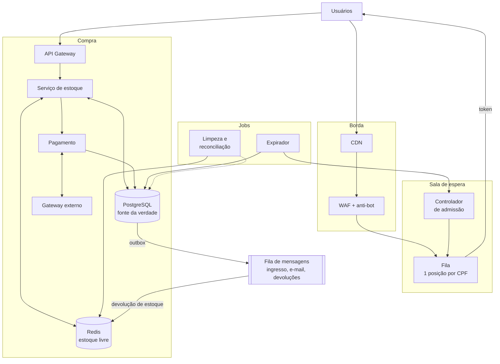
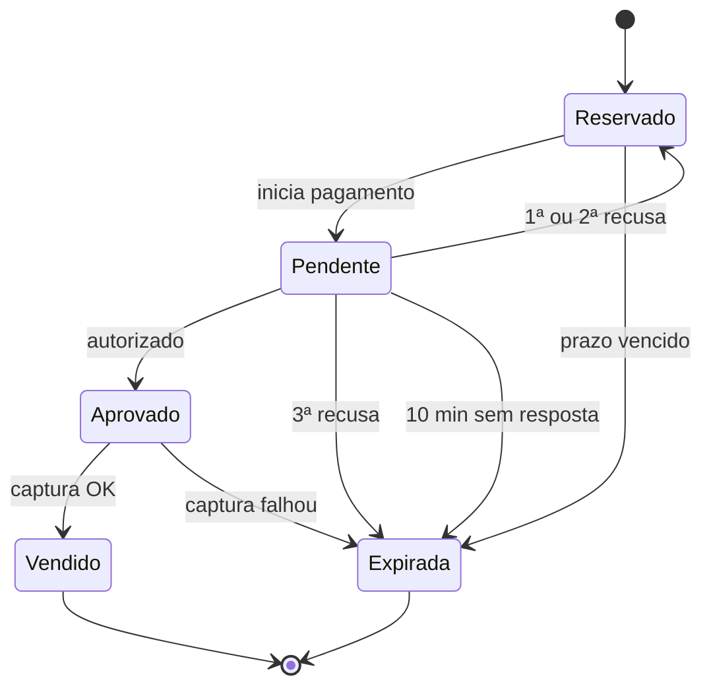
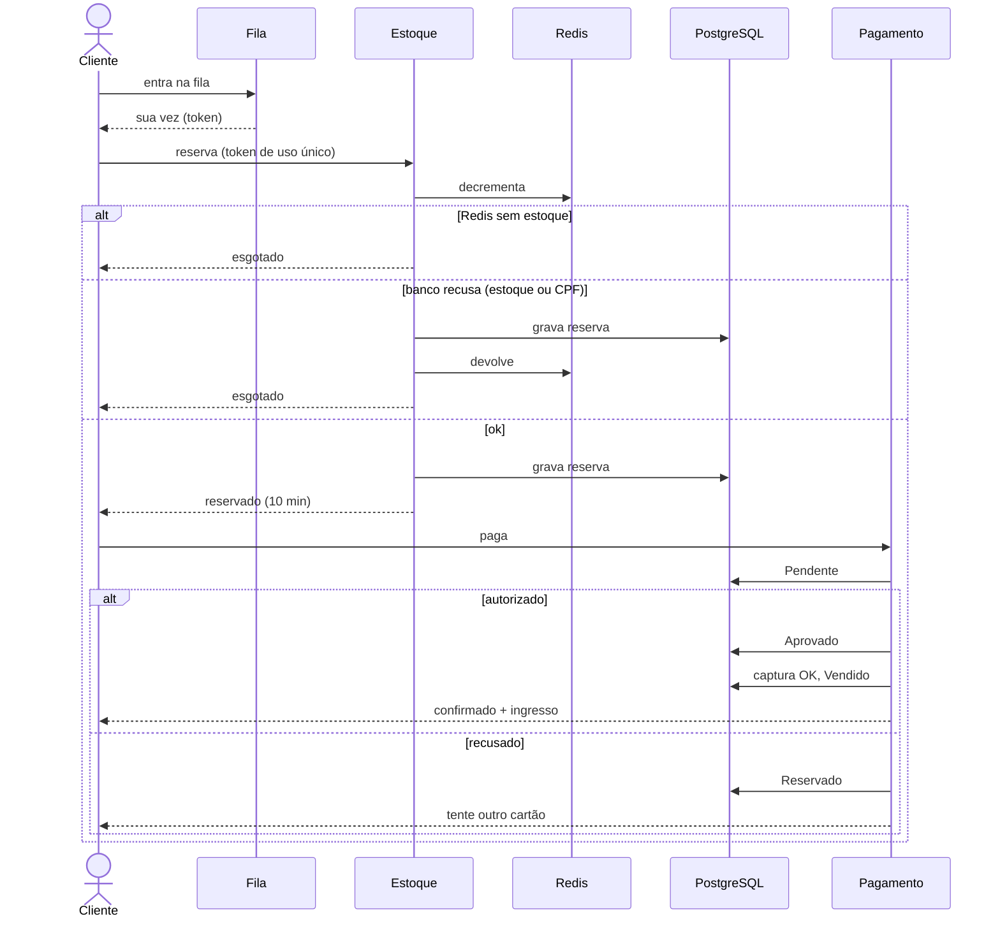

# Arquitetura: venda de ingressos para um mega show de rock

Requisitos:

1. **Aguentar qualquer volume de acessos** sem derrubar o site.
2. **Nunca vender mais ingressos do que existem.**
3. **Justiça**: internet lenta não perde para internet rápida.

Ideia central: a multidão fica em uma **fila virtual** servida pela borda. Só entra na compra quem tem chance real, cada ingresso é **reservado de forma atômica** antes do pagamento e o cartão só é cobrado com o ingresso garantido.

---

## 1. Visão geral



---

## 2. Escala

- **CDN** serve as páginas do evento e da fila. O pico bate na borda, não nos servidores.
- **WAF / anti-bot** descarta bots e excesso de requisições.
- **Fila**: servidores sem estado; as posições ficam em um sorted set no Redis e cada usuário faz só um polling leve. A posição também vai num token assinado que fica com o cliente (horário de chegada ou número sorteado).
- **Controlador de admissão** libera só a vazão que o checkout aguenta, seja qual for o tamanho da fila. Se o checkout ficar lento, reduz a vazão.
- **Ingresso e e-mail** saem do caminho crítico pela fila de mensagens (outbox).
- Tudo com autoscaling e multi-AZ.

---

## 3. Sem overselling

**Admissão**: libera pessoas pelo estoque livre, descontando quem já foi admitido e ainda não reservou (no pior caso, cada um compra o limite por CPF). A admissão vale 5 min fixos; vencida, o expirador devolve a vaga e a pessoa volta para o início da fila uma vez (na segunda, vai para o fim). Quem deixa a reserva expirar sem pagar pode entrar de novo, no fim da fila. Sem estoque e sem reservas que possam voltar, a fila mostra "esgotado" na hora.

**Reserva** (orquestrada pelo Serviço de estoque):

1. **Redis**, script Lua atômico: se há estoque, decrementa e marca a reserva (id gerado antes) como "em trânsito".
2. **PostgreSQL**, uma transação:
   ```sql
   UPDATE lote SET reservados = reservados + :quantidade
    WHERE id = :lote_id AND vendidos + reservados + :quantidade <= total;
   INSERT INTO limite_cpf (cpf, quantidade) VALUES (:cpf, :quantidade)
   ON CONFLICT (cpf) DO UPDATE SET quantidade = limite_cpf.quantidade + :quantidade
    WHERE limite_cpf.quantidade + :quantidade <= :limite_por_cpf;
   INSERT INTO reserva (id, token_admissao, ..., status, expira_em)
   VALUES (:reserva_id, :token_admissao, ..., 'RESERVADO', now() + interval '10 minutes');
   ```
   A quantidade pedida nunca passa do limite por CPF (validado na entrada). `token_admissao` é `UNIQUE`: o token é de uso único, então duas abas não reservam em dobro. Qualquer comando com 0 linhas afetadas cancela a transação. A transação tem `transaction_timeout` de 5 s.
3. Se o banco confirmar, tira a marca de "em trânsito". Se recusar explicitamente, o Redis devolve o estoque. Se recusar por token repetido (cliente tentando de novo depois de um timeout), o Redis devolve o estoque e o serviço responde com a reserva que já existe. Em timeout (resultado desconhecido), não devolve nada e deixa para o job de "em trânsito".

**Estados**: toda transição é um `UPDATE ... WHERE status = <estado esperado>`, então expirador e webhook nunca agem na mesma reserva.



- O prazo **não vence durante o pagamento**: quem paga no último segundo não perde o ingresso. Enquanto `Pendente`, o gateway é consultado a cada 1 min; sem resposta em 10 min contados do início daquela tentativa, a autorização é cancelada e a reserva expira.
- **Recusado** volta para `Reservado` com pelo menos 2 min para outro cartão. São no máximo 3 tentativas, então o tempo total que uma reserva segura o estoque tem limite.
- O cartão é **autorizado** primeiro e **capturado** em `Aprovado`. O ingresso só é emitido em `Vendido`, depois da captura: ninguém recebe ingresso sem pagar, e ninguém é cobrado sem receber.
- Chave de idempotência por tentativa (id da reserva + número da tentativa): clique duplo ou webhook repetido não cobra duas vezes, e um cartão novo não recebe a recusa guardada do anterior.
- A expiração é decidida pelo `expira_em` no PostgreSQL. Ao expirar, o expirador devolve estoque e limite do CPF no banco e grava no outbox um evento de devolução para o Redis.

---

## 4. Falhas e recuperação

- **Job de "em trânsito"**: só olha marcas com mais de 1 min (bem acima do `transaction_timeout` de 5 s, então nenhuma transação ainda pode comitar) e consulta a reserva pelo id. Se ela existe, só tira a marca; se não, devolve o estoque.
- **Devolução ao Redis**: vem do outbox e é idempotente (um script Lua registra o id da reserva já devolvida). Se o expirador cair depois do commit, o evento continua lá e é processado depois.
- **Gateway indeciso ou cancelamento falhando**: o cancelamento é repetido até ser confirmado. Uma aprovação que chegue para uma reserva já `Expirada` é cancelada ou estornada automaticamente, e o cliente é avisado.
- **Captura**: um job varre reservas em `Aprovado` há mais de 2 min (por exemplo, se o serviço caiu depois da autorização) e repete a captura com a mesma chave de idempotência. Se ela não passar, a autorização é cancelada com o mesmo retry do item anterior, a reserva expira, o estoque volta e o cliente não é cobrado.
- **Reconciliação**: lê o banco em um snapshot, desconta as reservas em trânsito e as devoluções ainda no outbox, e só corrige divergências que persistem em leituras seguidas. A correção aplica a diferença (`INCRBY`), nunca sobrescreve o contador.
- **Redis da fila**: réplica e AOF. Se um failover perder posições, o cliente reapresenta o token assinado no próximo polling e volta exatamente para onde estava.

---

## 5. Justiça

- **Login com CPF**: uma posição por pessoa, não por aba ou dispositivo.
- **Sorteio**: a fila abre 30 min antes, e todos que entraram até a abertura recebem posição aleatória.
- **Depois da abertura**: ordem de chegada medida na borda, não no carregamento da página.
- **Posição garantida**: fica no servidor e num token assinado. Cair a conexão, recarregar ou um failover não mudam a posição.
- **Janela tolerante**: na sua vez, 5 min fixos para reservar. Se a conexão cair, o polling recebe de novo o token, com o mesmo prazo. Se a janela vencer, a pessoa ganha uma segunda chance no início da fila.
- **Reserva de 10 min** contada no servidor. Cartão recusado não libera o ingresso: há pelo menos 2 min para tentar outro.
- **Páginas leves**, que funcionam em 3G.

---

## 6. Fluxo de compra


