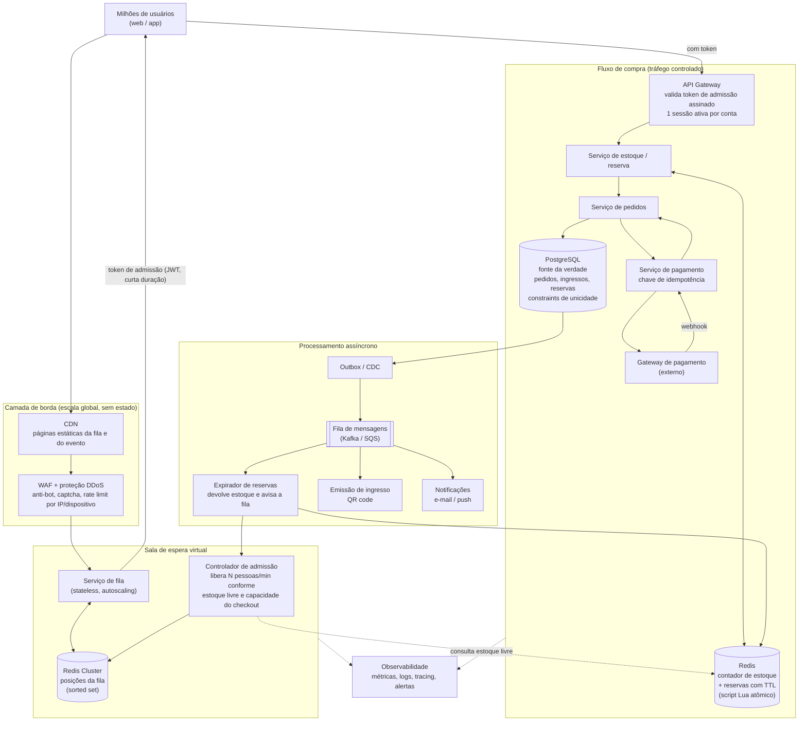
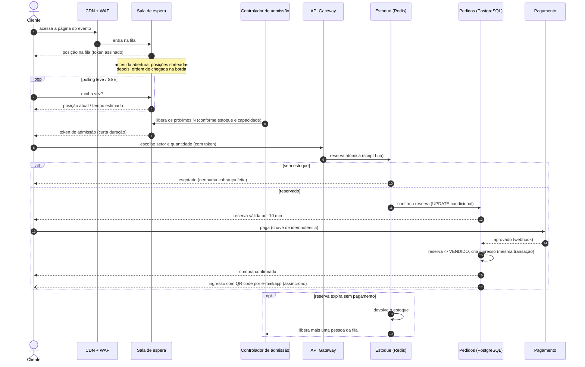
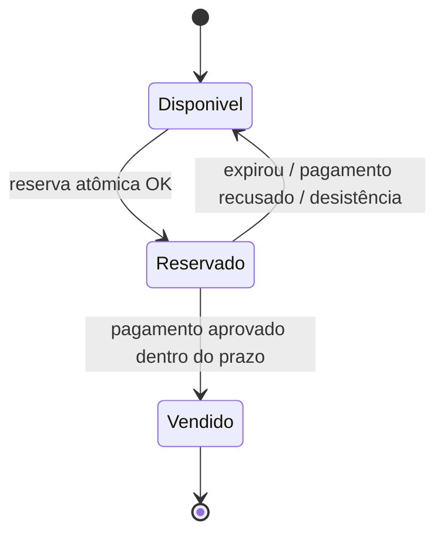

# Arquitetura: venda de ingressos para um mega show de rock

Desenho de um sistema de venda de ingressos para um evento com demanda muito maior que a oferta. Ele é guiado por três requisitos:

1. **Aguentar qualquer volume de acessos simultâneos** sem derrubar o site.
2. **Nunca vender mais ingressos do que existem** (sem overselling, sem "compra aprovada e depois cancelada").
3. **Justiça**: uma pessoa com internet lenta não pode perder o ingresso só porque outra tem conexão mais rápida.

A ideia central: **o estoque não é disputado pela multidão**. A multidão fica em uma fila virtual barata, servida pela borda (CDN). Só entra no fluxo de compra quem tem chance real de comprar, e cada ingresso é **reservado de forma atômica** antes do pagamento.

---

## 1. Visão geral



---

## 2. Como cada requisito é atendido

### 2.1 Volume de acessos independente da demanda

| Camada | Como escala |
|---|---|
| **CDN** | Serve a página do evento e a página da fila como conteúdo estático. O pico de milhões de acessos bate na borda, não nos servidores. |
| **WAF / anti-bot** | Descarta bots, scalpers e excesso de requisições antes de chegar à aplicação. |
| **Sala de espera** | Serviço sem estado, escala horizontalmente. Cada usuário custa só uma entrada em um sorted set no Redis e um polling leve (ou SSE) a cada poucos segundos. |
| **Controlador de admissão** | É a "válvula": o fluxo de compra recebe só a vazão que consegue processar, não importa se há 100 mil ou 10 milhões na fila. |
| **Fluxo de compra** | Como a entrada é controlada, o banco de dados nunca recebe a avalanche. Serviços em containers com autoscaling, multi-AZ. |
| **Assíncrono** | Emissão do ingresso, e-mail e push saem do caminho crítico pela fila de mensagens. |

A fila também **para de admitir quando não há mais estoque possível**: se `vendidos + reservados ativos = total`, ninguém novo entra; se todas as reservas foram vendidas, a fila mostra "esgotado" imediatamente, em vez de deixar milhões de pessoas esperando à toa.

### 2.2 Nunca vender o que não existe

O ingresso é garantido **antes** do pagamento, em dois níveis:

1. **Reserva atômica no Redis** (script Lua, executado de forma indivisível):
   ```
   se estoque_livre >= quantidade:
       estoque_livre -= quantidade
       cria reserva(id, usuario, quantidade, expira_em = agora + 10 min)
       retorna OK
   senão:
       retorna ESGOTADO
   ```
   Dois usuários nunca conseguem o mesmo ingresso, porque o Redis executa o script em série.

2. **Confirmação no PostgreSQL** (fonte da verdade), dentro de uma transação:
   ```sql
   UPDATE lote
      SET reservados = reservados + :quantidade
    WHERE id = :lote_id
      AND vendidos + reservados + :quantidade <= total;
   -- 0 linhas afetadas => sem estoque, a reserva é recusada
   ```
   Mais uma constraint `UNIQUE` por ingresso/assento. Se o Redis falhar ou divergir, o banco ainda impede a venda acima do total.

3. **Pagamento só com reserva válida.** O pedido carrega o id da reserva. Quando o pagamento é aprovado, a mesma transação muda a reserva para `VENDIDO` e cria o ingresso. Se a reserva já tivesse expirado (caso raro, ex.: webhook muito atrasado), o pagamento é estornado automaticamente. A compra **só é finalizada para quem de fato recebe o ingresso**.

4. **Idempotência**: cada tentativa de pagamento tem uma chave de idempotência, então cliques duplos, retries do cliente ou webhooks repetidos não geram dupla cobrança nem dois ingressos.

5. **Expiração**: reservas não pagas expiram pelo TTL. O expirador devolve o estoque e avisa o controlador de admissão, que libera a próxima pessoa da fila.

### 2.3 Justiça para quem tem internet lenta

A velocidade da conexão deixa de importar porque **a ordem é decidida no servidor, não por quem clica primeiro**:

- **Pré-fila com sorteio**: a sala de espera abre antes do horário da venda (ex.: 30 min antes). Todos que entrarem até a abertura recebem uma **posição aleatória** no momento da abertura. Chegar 1 ms ou 20 min antes dá a mesma chance.
- **Depois da abertura**, quem chega entra no fim da fila pelo **horário em que a requisição chegou na borda** (CDN), não pelo tempo de carregamento da página.
- **A posição é guardada no servidor** e amarrada a um token assinado. Se a conexão cair ou o usuário recarregar a página, ele volta para a mesma posição.
- **O tempo de reserva começa a contar no servidor** e é generoso (ex.: 10 min) para preencher dados e pagar, com aviso de quanto tempo resta. Ninguém "rouba" o ingresso de quem já está no checkout.
- **Páginas leves**: fila e checkout são páginas pequenas, servidas pela CDN, com polling de poucos bytes. Funcionam bem em 3G.
- **Anti-bot e limite por conta/CPF**: impede que scripts automatizados (a verdadeira "internet rápida") furem a fila e limita a quantidade de ingressos por pessoa.

---

## 3. Fluxo de compra



---

## 4. Estados de um ingresso



---

## 5. Resiliência e operação

- **Multi-AZ** em todos os componentes; Redis em cluster com réplica; PostgreSQL com réplica síncrona e failover automático.
- **Degradação controlada**: se o fluxo de compra ficar lento, o controlador de admissão reduz a vazão automaticamente (baseado em latência e taxa de erro), em vez de deixar o sistema cair.
- **Reconciliação**: job periódico compara o contador do Redis com o PostgreSQL e corrige divergências (o banco sempre vence).
- **Outbox pattern**: eventos de venda são gravados na mesma transação do pedido e publicados depois, então nenhum ingresso vendido fica sem emissão.
- **Pré-aquecimento**: escala dos serviços e da CDN aumentada antes do horário de abertura, com teste de carga simulando o pico esperado.
- **Observabilidade**: tamanho da fila, taxa de admissão, reservas ativas, estoque livre, taxa de aprovação de pagamento e latência por etapa em um dashboard com alertas.

---

## 6. Resumo

| Requisito | Solução |
|---|---|
| Acessos ilimitados | CDN + sala de espera virtual sem estado; o núcleo só recebe tráfego controlado |
| Sem overselling | Reserva atômica (Redis Lua) + UPDATE condicional e constraints no PostgreSQL + pagamento só com reserva válida |
| Justiça | Sorteio na abertura, ordem decidida no servidor, posição persistente, prazo de reserva generoso, anti-bot |
