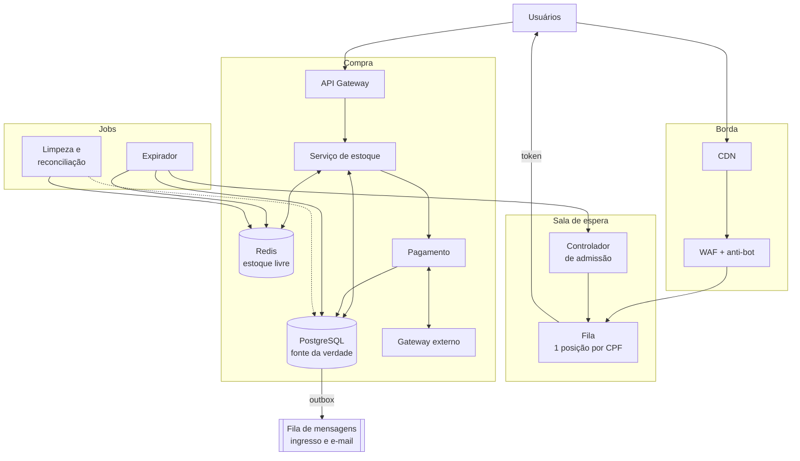
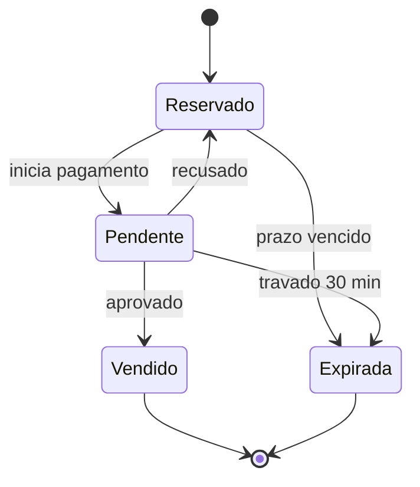
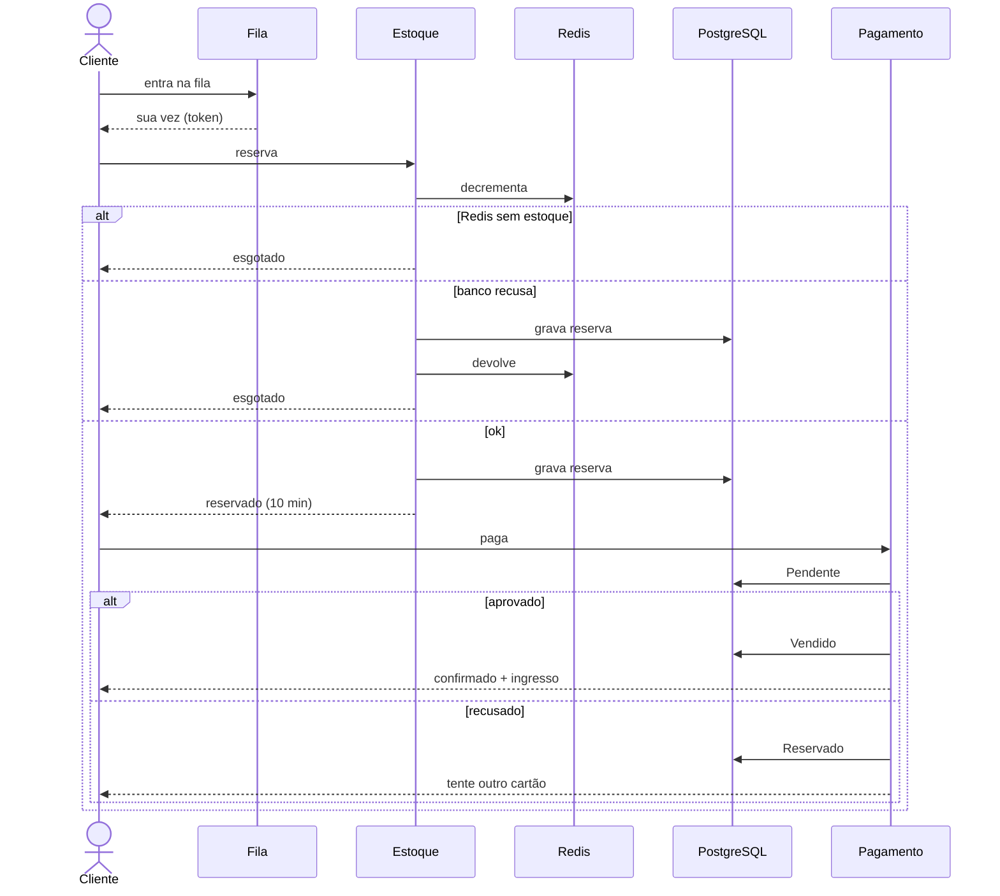

# Arquitetura: venda de ingressos para um mega show de rock

Requisitos:

1. **Aguentar qualquer volume de acessos** sem derrubar o site.
2. **Nunca vender mais ingressos do que existem.**
3. **Justiça**: internet lenta não perde para internet rápida.

Ideia central: a multidão fica em uma **fila virtual** servida pela borda. Só entra na compra quem tem chance real, cada ingresso é **reservado de forma atômica** antes do pagamento e o cartão só é cobrado com o ingresso garantido.

---

## 1. Visão geral



---

## 2. Escala

- **CDN** serve as páginas do evento e da fila. O pico bate na borda, não nos servidores.
- **WAF / anti-bot** descarta bots e excesso de requisições.
- **Fila** sem estado: cada usuário é uma entrada em um sorted set no Redis e um polling leve.
- **Controlador de admissão** libera só a vazão que o checkout aguenta, seja qual for o tamanho da fila. Se o checkout ficar lento, reduz a vazão.
- **Ingresso e e-mail** saem do caminho crítico pela fila de mensagens (outbox).
- Tudo com autoscaling e multi-AZ.

---

## 3. Sem overselling

**Admissão**: libera pessoas pelo estoque livre, descontando quem já foi admitido e ainda não reservou (no pior caso, cada um compra o limite por CPF). Sem estoque e sem reservas que possam voltar, a fila mostra "esgotado" na hora.

**Reserva** (orquestrada pelo Serviço de estoque):

1. **Redis**, script Lua atômico: se há estoque, decrementa e marca a reserva como "em trânsito".
2. **PostgreSQL**, uma transação:
   ```sql
   UPDATE lote SET reservados = reservados + :quantidade
    WHERE id = :lote_id AND vendidos + reservados + :quantidade <= total;
   INSERT INTO reserva (..., status, expira_em) VALUES (..., 'RESERVADO', now() + interval '10 minutes');
   ```
3. Se o banco confirmar, tira a marca de "em trânsito". Se recusar, o Redis devolve o estoque. Se o serviço cair no meio, um job devolve as reservas "em trânsito" sem registro no banco.

**Estados**: toda transição é um `UPDATE ... WHERE status = <estado esperado>`, então expirador e webhook nunca agem na mesma reserva.



- O expirador **não toca** reservas em `Pendente`: quem paga no último segundo não perde o ingresso. Só depois de 30 min travado ele consulta o gateway: se aprovado, vira `Vendido`; senão, cancela a autorização e expira.
- Recusado volta para `Reservado` com pelo menos 2 min de prazo para tentar outro cartão.
- O cartão é **autorizado** ao iniciar e **capturado** só depois de `Vendido`. Não existe "aprovado e depois estornado".
- Pagamento com chave de idempotência: clique duplo ou webhook repetido não cobra duas vezes.
- A expiração é decidida pelo `expira_em` no PostgreSQL. Ao expirar, o expirador devolve o estoque no banco e no Redis e libera mais gente da fila.
- A reconciliação compara Redis e banco, descontando as reservas em trânsito.

---

## 4. Justiça

- **Login com CPF**: uma posição por pessoa, não por aba ou dispositivo.
- **Sorteio**: a fila abre 30 min antes, e todos que entraram até a abertura recebem posição aleatória.
- **Depois da abertura**: ordem de chegada medida na borda, não no carregamento da página.
- **Posição no servidor**: cair a conexão ou recarregar não muda a posição.
- **Janela tolerante**: na sua vez, 5 min para reservar, com token reemitido a cada polling.
- **Reserva de 10 min** contada no servidor. Cartão recusado não libera o ingresso.
- **Páginas leves**, que funcionam em 3G.

---

## 5. Fluxo de compra


